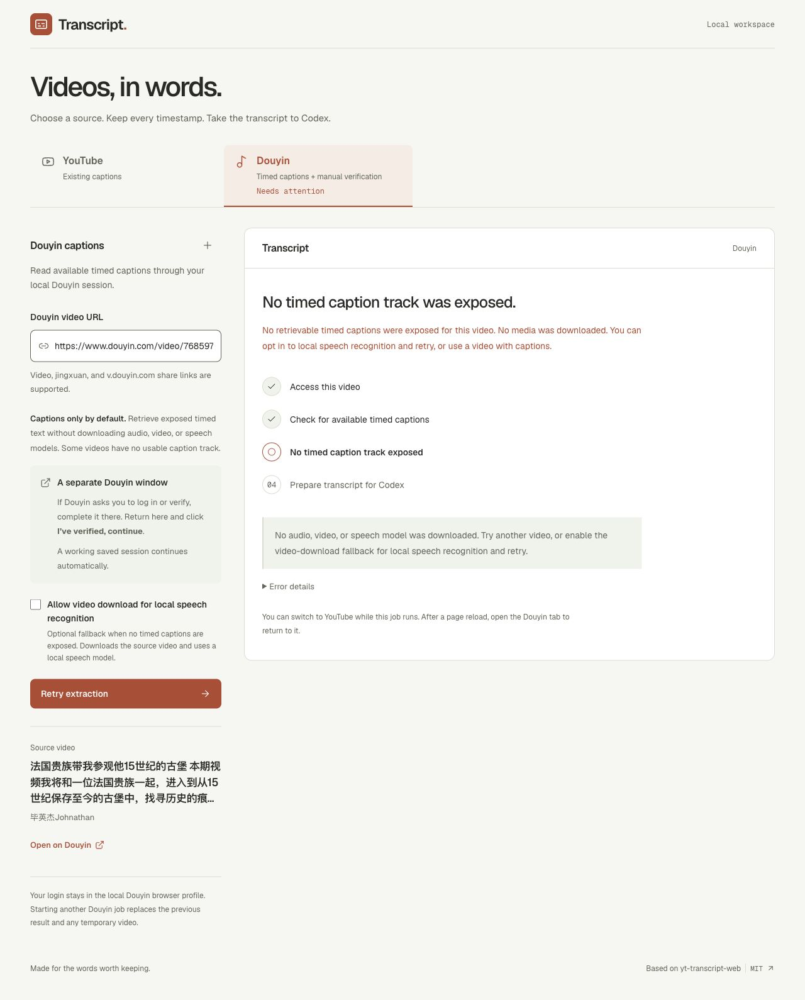

# Douyin: existing captions first

**The default mode retrieves exposed timed captions without downloading the video.** A dedicated browser handles normal site access and any manual login or verification. The app inspects matching video metadata, refreshes only that video's detail data when needed, and reads the selected caption asset into memory. Player media stays blocked during the caption probe. If no usable timed track is exposed, the app reports that limitation.

The optional video-download/local-speech fallback succeeded on four public videos across 2026-10-08–11. Those runs demonstrate speech extraction and local playback, not native caption availability. Other videos can still require manual verification or refuse access. See [VERIFICATION.md](../VERIFICATION.md) for current checks and the historical live results.

On 2026-10-12, the original [31-minute video](https://www.douyin.com/video/7685972770793999667) returned matching metadata through the saved session, but no exposed timed track. The app reported `captions_not_found`, with `caption_probe_complete=true` and `media_downloaded=false`. It did not invoke video acquisition or speech recognition. This is a real availability check, not a successful native-caption extraction. Direct caption retrieval still needs a positive live sample; synthetic regressions cover its successful path.

## Use it

1. Run `./setup.sh` and `./start.command` as usual. Chrome is used when installed; setup installs Playwright Chromium otherwise. Douzy is not required.
2. Open the **Douyin** tab, then paste an individual HTTPS Douyin video link, a `jingxuan?modal_id=…` link, or a `v.douyin.com` share link. Leave **Allow video download for local speech recognition** off for captions only. No speech environment or model is needed.
3. Click **Extract transcript**. A dedicated browser opens the official Douyin page and reuses its saved session. If the page returns this video's metadata, extraction proceeds automatically. If Douyin requires a login, CAPTCHA or identity check, complete it yourself on its official page. Then click the **same primary button**, now labelled **I’ve verified, continue**, in the extractor. Keep the browser open until caption retrieval finishes. Video playback is intentionally paused/blocked during this probe; playing the video is not required to retrieve an exposed text track.
4. If several caption tracks are exposed, select one in **Caption track** and click **Use selected captions**. A single track proceeds automatically. The app reads inline timed utterances or the selected JSON/SRT/WebVTT asset, preserving source wording and start/end timing. The language, track, and source are recorded in the result. No separate download app or reply to Codex is needed.
5. If no usable timed track is exposed, **No timed caption track was exposed** appears. You can try another video or explicitly enable **Allow video download for local speech recognition** and retry. For that fallback on an Apple Silicon Mac, install FFmpeg (`brew install ffmpeg`) and run `./setup-douyin.sh` once. It creates a separate Python 3.12 environment, installs locked MLX dependencies, and verifies pinned Whisper large-v3-turbo model files by SHA-256. Model weights use about 1.6 GB; dependencies need additional disk space. Restart the server after setup. Opting in permits a temporary video download, an audio check and local transcription when captions are absent.
6. The progress panel shows access, acquisition, speech recognition and handoff preparation. You can switch to YouTube without stopping the job or losing either transcript. Reloading the page opens YouTube first; select the Douyin tab to restore the current job while the server remains running. If speech processing fails after acquisition, **Retry speech recognition** reuses that video without a new browser session or download. Other failures show **Retry extraction**. **Error details** exposes a safe error code and worker exit number, never a raw traceback or browser secrets.
7. Search, follow a source link, or **Copy for Codex** / **Download for Codex**. Caption-only results keep platform timing but have no local player, and Douyin's public links do not guarantee exact seeking. When the opt-in fallback acquired a video, its local timestamp links can seek that copy. Speech text and word timing are estimates: check names, numbers and flagged cues. On-screen translations and scene text are not recovered. The app prepares the handoff; you submit it in your Codex chat.

The local player exists only after the optional speech fallback acquired media. It supports fractional `#t=SECONDS` jumps and HTTP range playback. Keep the extractor running on the same computer while Codex inspects screenshots. The local player expires when another Douyin job starts or the server stops. Local links do not work for someone else on GitHub. Public Douyin links are preserved for attribution; exact seeking on those links is not claimed.

## Separate channel

The **YouTube** tab uses existing captions and has no browser-verification or speech controls. The **Douyin** tab keeps its own source and progress, and shows **Needs verification**, **Extracting**, or **Ready** even while YouTube is selected. The **+** beside a channel heading clears that channel's form after extraction; a running Douyin job must finish or be cancelled first. Switching tabs never starts or cancels a job.

This historical screenshot restores the real 237-segment speech result from 2026-10-11. It shows the video-download fallback, not direct caption retrieval. The current form defaults to captions only and leaves the fallback unchecked. The older screenshots below show earlier interface versions.

## Example result

This real 2026-10-08 result contains **466 segments** from a 31-minute public video. The approximately **19,301-token** estimate covers the full exported text and prompt; subsequent Codex reasoning, tool calls, screenshots, and replies add usage. Copy and download include every segment even when search shows only a few. The screenshot demonstrates the extractor's output, not the correctness of every recognized word. Video and caption excerpts belong to their respective owners. The media, complete transcript, login profile, and worker logs are excluded from the repository.

### Additional video checks — 2026-10-11

This [7-minute source video](https://www.douyin.com/video/7631965839184432424) produced **237 segments** and an approximately **9,616-token** handoff. Search shows one matching cue, while copy/download retain all 237. Its long Chinese title exposed a filename-length bug; the corrected download was compared byte-for-byte with the full copied transcript. No complete transcript is distributed here.

The local player was inspected at **152.300 and 300.500 seconds**. A second [3-minute physics video](https://www.douyin.com/video/7687991485467966031) produced **65 segments**, with complete copy/download comparison and inspected frames at **36.280 and 95.800 seconds**. These checks establish local seeking and handoff completeness, not exact ASR accuracy or the first appearance of a visual. Source imagery and captions belong to their creators. The screenshot's local link is not a live video hosted by this repository.

## Troubleshooting

| What you see | What to do |
| --- | --- |
| A Douyin login, CAPTCHA, or identity prompt | Complete it yourself in the dedicated official-page browser. Return and click **I’ve verified, continue**. Use **Show Douyin window** if it is behind another window. Do not paste credentials or ID documents into this app or Codex. |
| `douyin_verification_blocked` after confirming | Check that the dedicated browser is on the exact official video page and complete any remaining site check. Retry extraction if appropriate; verification may still not grant metadata access, and this app cannot bypass that restriction. Player media is intentionally blocked during caption probing. |
| `speech_setup_required`, `speech_runtime_missing`, or `model_missing` | On Apple Silicon, install FFmpeg and run `./setup-douyin.sh` from the project root. Check any custom `STT_PYTHON` / `STT_MODEL_DIR` paths. Restart after changing `.env`, then use the displayed retry action. |
| Speech processing fails after the video was acquired | Click **Retry speech recognition**. This reuses validated media; no new browser login or download is needed. The current failed job is retained only until replaced or shutdown. |
| `no_audio`, refused media, or a connection failure | Follow the error message and use **Retry extraction**. Alternate returned playback variants are tried automatically; not every video exposes usable media. |
| `captions_not_found` and speech recognition is off | No timed track was exposed by the inspected metadata. No video/audio/model download is started. Try a video with captions, or explicitly allow the video-download fallback after speech setup and retry. Burned-in subtitles are pixels; OCR is not implemented. |
| `caption_request_failed` or `captions_invalid` | An advertised track could not be read or did not contain valid timed text. Retry or try another available track. This is distinct from missing captions and does not silently trigger a video download. |
| Progress disappears after reloading | Reload restores only the current job in the same running server. A restart clears jobs. Starting another extraction replaces the previous one. |
| A local timestamp link is missing or expired | Local playback exists only when this job acquired media. Keep that server/job running on the same computer. A caption-only Douyin result retains its public source URL but has no local video to seek. |
| Codex cannot open the player or capture screenshots | Check that Codex has browser/screenshot tools and can access localhost on this computer. The skill cannot grant those capabilities. Ask for a caption-only brief and identify the unverified visuals; do not treat caption positions as verified visual timestamps. |
| Downloads do not complete | Update the app if a long Chinese/emoji title caused the failure; filenames now respect common byte limits. If your embedded browser still prevents downloads, use **Copy for Codex** or open the extractor in a regular browser. Both handoffs contain the same full text. |

Selecting **New transcript** starts a new form; the previous Douyin media is removed when a new Douyin job actually starts, or when the server stops. Save any transcript you want to keep before replacing the result.

## Acquisition boundaries

The app opens one official video page in its dedicated persistent browser and observes matching public metadata from page responses or `RENDER_DATA`. A narrow refresh can issue only `GET /aweme/v1/web/aweme/detail/?aweme_id=<requested ID>` from that official page; the page retains its own normal authentication and request handling. This is not a generic request proxy. IDs are parsed from returned text in Python to preserve their full numeric precision.

Caption discovery examines explicit subtitle fields, including `interaction_stickers[].auto_video_caption_info.auto_captions`, `video.cla_info.caption_infos`, and `video.subtitleInfos`. These formats are documented by the public [yt-dlp caption parser](https://github.com/yt-dlp/yt-dlp/blob/master/yt_dlp/extractor/tiktok.py#L308-L359); its [Douyin extractor](https://github.com/yt-dlp/yt-dlp/blob/master/yt_dlp/extractor/tiktok.py#L1411-L1422) routes detail data through the shared parser. The implementation here is independent. The upstream branch can move, and supporting these formats does not prove a particular video exposes them.

Valid inline `utterances`, or caption assets with millisecond `start_time`/`end_time`, SRT, or WebVTT cues, supply the transcript. Repeated and overlapping cues, line breaks and fractional timing are retained. Malformed tracks fail explicitly instead of silently discarding invalid segments. Caption assets are fetched in the same browser into bounded memory, with redirects and non-text media responses rejected. Their private/signed URLs are omitted from public results.

The browser guard blocks player media requests and known media URLs during caption probing, pauses autoplay and blocks service workers. This mode does not call the video downloader or speech worker. Ordinary page/login assets can still load. If no captions are exposed, the result is an availability error—not a generated transcript. A video description, music metadata, an AI summary, or subtitles burned into video pixels cannot substitute for a timed track. A `music.playUrl` address may contain background music rather than the video's complete narration, so it is not used as an audio-only speech shortcut.

The app does not forge signatures, replay private desktop code, solve challenges automatically, scrape account lists, or import cookies from Douzy or another browser profile. It processes one individual video at a time. Normal manual verification may still not grant access to metadata or caption assets.

The [upstream downloader](https://github.com/jiji262/douyin-downloader) documents CLI API-request verification failures and describes a desktop browser bridge in its [maintainer instructions](https://github.com/jiji262/douyin-downloader/blob/main/AGENTS.md). Local architectural study of Douzy also informed three general design choices: a persistent manually verified browser, narrowly scoped page operations, and explicit worker states. Those lessons are implemented independently with [Playwright](https://playwright.dev/python/docs/network). Douzy is not installed, called or bundled by this project, and no recovered proprietary source or assets are included. This does not establish a blanket project ban or guarantee access to every video.

## Local data and setup

- Login stays in `~/.local/share/efficient-content-extractor/douyin-browser/`, a dedicated Chromium profile with owner-only directory permissions. Caption requests use that browser's session without exporting cookies. Only the opt-in media downloader uses needed cookies in memory for an allowlisted returned media address; values are never exported to the transcript or logged. The app does not store an ID document or ask for credentials in its UI.
- Caption-only text and normalized results stay in memory until copied/downloaded or the job is replaced/server stops. The browser's persistent profile is separate from transcript storage. An owner-only `transcript-douyin-*` directory is allocated for the job, but caption retrieval does not write a caption or video file there.
- For opt-in speech, temporary media, worker logs and transcript output are placed in that OS temporary directory. A speech failure keeps the current acquired video and worker log for retry. Jobs without validated audio and cancelled jobs are cleared. A completed media job is kept for local playback. The next job or normal shutdown clears the previous job, including failed retry data. A forced crash can leave these directories. Inspect and remove only this app's temporary directories if cleanup is needed.
- The model persists in `~/.cache/efficient-content-extractor/models/whisper-turbo/`. Inference uses local model files with Hugging Face offline mode; setup downloads model data separately. The app makes no cloud AI request or automatic upload.
- `.env` can override `DOUYIN_BROWSER_PROFILE`, `STT_PYTHON`, and `STT_MODEL_DIR` with absolute paths. Restart after changes. `STT_PYTHON`, if set, must point to the virtual environment executable (for example `/absolute/path/to/project/stt/.venv/bin/python`), not its resolved base-Python symlink target. The app checks MLX availability before acquisition. Do not point the browser profile at your everyday Chrome or Douzy data directory. Close its browser before removing the dedicated profile to sign out locally.
- YouTube retrieval remains caption-only. Douyin speech recognition currently requires Apple Silicon, Python 3.12 and FFmpeg; no Windows/Linux ASR backend is implemented.

## API and states

`POST /api/douyin/jobs` accepts `{"url":"https://www.douyin.com/video/7685972770793999667","allow_asr":false}`. Omitted `allow_asr` also defaults to false. Set it to true only to permit video acquisition and speech recognition when captions are absent. The response contains an unpredictable local job ID. Poll `GET /api/douyin/jobs/{id}`. `GET /api/douyin/current-job` restores the current job/result after a page reload.

POST `{}` to `/confirm` only after a requested manual check; in `waiting_track`, POST `{"track_id":"platform:0"}` to `/confirm` with a current returned track ID instead. `/show-browser` brings a waiting verification window forward; `/retry-speech` reuses a failed job's validated media; `/cancel` stops the job. The current completed job exposes `/viewer` and `/video` only when local media exists; the video endpoint supports range requests. Only one job is retained; a server restart clears jobs.

States: `opening_browser → reading_video → waiting_verification (only when needed) → reading_video → probing_captions → waiting_track (multiple tracks) → downloading_captions → completed`. When no track is exposed, captions-only ends with `captions_not_found`; explicit speech opt-in instead permits `downloading_media → transcribing → completed`. Failed speech jobs can return to `transcribing` through retry; cancellation ends a job. Errors distinguish invalid links, busy jobs, inaccessible metadata, absent captions, inaccessible/invalid caption assets, rejected media addresses, refused downloads, network failures, incomplete runtime/model setup, audio-less media, decoding failures, invalid speech timing, and speech processing failure. Browser challenges time out after 15 minutes; speech jobs after one hour. Media is limited to 1 GiB and caption responses to 10 MiB. Returned video variants are tried automatically for opt-in speech if acquisition or the audio check fails.

Results identify `source` (`platform` or `asr`), `provider`, selected `track_id`, `acquisition_provider`, `media_downloaded`, and `captions_only`. `captions_only` records the requested permission mode; `media_downloaded` records whether media was actually acquired. A job with speech allowed can still finish using existing captions and no media. Platform caption timings are source timings; speech timings remain estimated alignment.

Job status also exposes `caption_probe_complete`, `media_downloaded`, and `blocked_media_requests` for failures. The blocked-request counter records route interceptions; a zero count can mean the paused player never requested media and is not a measurement of total network traffic.

`manual_verification_confirmed` means the user clicked the primary button after a requested manual check in this job. It is false when a saved browser session works directly. Neither value certifies identity or proves Douyin performed an identity check.

## Validation record

- All four successful live video results below used downloaded media and local speech recognition. None is evidence that the same video exposes directly retrievable captions. Current caption-only implementation checks and any new live probe outcomes are recorded separately in [VERIFICATION.md](../VERIFICATION.md).
- System check on 2026-10-11: **88 backend tests, five multilingual subcases and 16 frontend tests** passed, plus lint/build, shell syntax and locked-dependency checks. Two additional videos freshly completed ASR and browser copy/download comparison; source frames and fractional local seek positions were inspected. The 21-minute Chinese failure was also corrected and retried successfully with **605 segments** on 2026-10-10. See [VERIFICATION.md](../VERIFICATION.md) for the complete matrix, YouTube blocked-request results, and limits.
- Release checks on 2026-10-10: **86 backend tests and 15 frontend tests** passed; Ruff, ESLint, the frontend production build and shell syntax checks passed. Regressions include normal saved-session playback, one manual confirmation through caption completion, automatic fallback to a media variant with audio, safe worker diagnostics, speech retry without reopening the browser, reload status, origin checks, range playback, accurate exports, and existing YouTube extraction behavior. These offline checks do not perform real identity verification or download media/model weights.
- Live test: video `7685972770793999667` was freshly acquired through this adapter as a 1280×720 video with audio (90,670,052 bytes; duration 1,891.861 seconds). No old Douzy copy was used. Offline MLX Whisper large-v3-turbo produced 466 cues in 88.3 seconds, including audio extraction but excluding download time, with about 3.14 GiB peak MLX allocation. This is a sample, not an accuracy or speed guarantee.
- First cue: `00:00:00.000–00:00:04.440`; last cue: `00:31:24.240–00:31:25.260`. The final seconds contain no additional recognized cue. The transcript is recognized speech, not verified original subtitles; 138 cues were flagged for review. Names, foreign phrases, music and silence still need checking.
- Browser verification: the running job survived a page reload; the result displayed 466 segments; Copy for Codex and both browser-downloaded Markdown files matched the full export exactly. A clicked `06:42` link opened the local player at `402.480` seconds, with the expected source frame and playable video. The handoff estimate displayed approximately 19,301 input tokens, excluding later AI/tool/image usage.
- The live test exposed an interpreter configuration failure (`mlx` absent from base Python). The runtime path was corrected to the isolated virtual environment, and a preflight check now detects missing MLX before download. Synthetic tests verify that failures after acquisition retain the video for direct speech retry.
- Live verification did not trigger a new identity challenge because the existing session worked. The manual pause/confirm path is covered by offline regression tests; users must still perform real site challenges themselves. The later two-video check above adds sample coverage, not universal access or live confirmation of every caption schema and URL type.

Future work includes more real exposed-caption samples, broader caption schemas, music/silence handling, portable speech backends, importing a user-selected local file, and an extension that seeks the original active player. Native DOM text tracks are a possible additional provider when a player exposes them, but no such Douyin provider or guarantee is shipped here.
